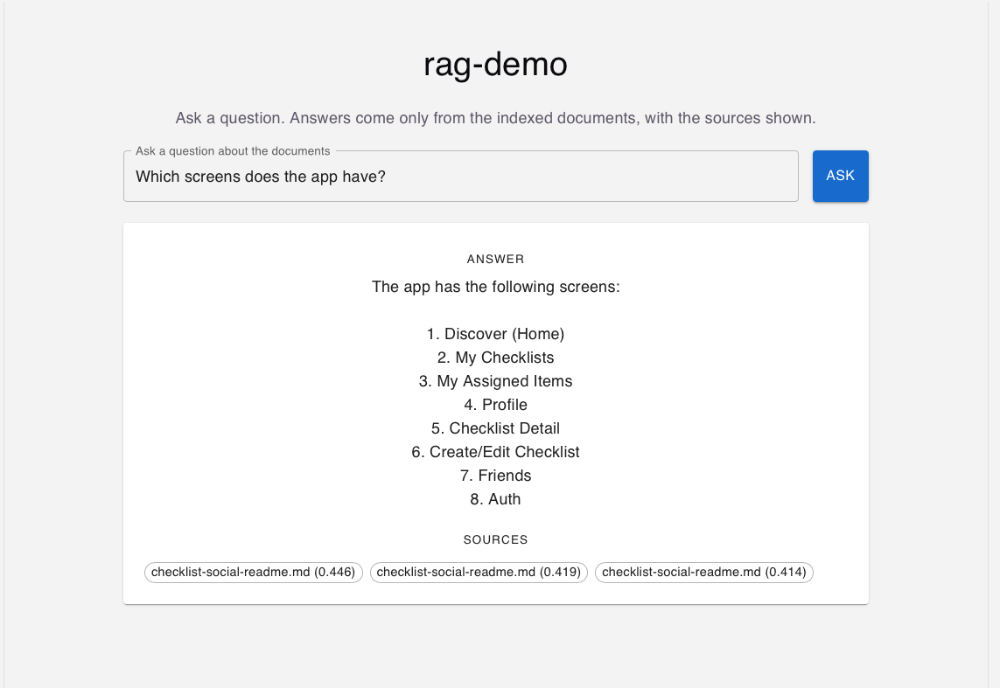

# rag-demo

A minimal Retrieval-Augmented Generation (RAG) prototype in TypeScript. It answers questions using only the content of my own documents, with the sources it used shown next to each answer.

The project is written without LangChain or LlamaIndex on purpose, so every step (chunking, embeddings, similarity search, prompt construction) is visible and can be explained.



## Status

| Stage | Status |
|---|---|
| Document loading | Done |
| Chunking | Done |
| Embeddings and local vector store (JSON) | Done |
| Similarity search with score threshold | Done |
| Answer generation with source grounding | Done |
| Command-line interface (`src/ask.ts`) | Done |
| Evaluation script (`npm run eval`) | Done |
| Express API (`POST /ask`, `GET /health`) | Done |
| React front end (`client/`) | Done |

## How it works

```
Ingest (run once or when documents change)
  documents -> chunkText -> embed each chunk -> src/store/embeddings.json

Query (run for each question)
  question -> embed question -> cosine similarity against all chunks
           -> keep top 3 chunks with score >= 0.35
           -> if nothing passes the threshold: return "no information"
           -> otherwise: send chunks + question to the chat model
           -> answer + list of sources (file name and score)
```

The key idea: the model never answers from its general knowledge when the documents do not cover the question. Retrieval decides what the model sees, and a threshold decides whether the model is called at all.

## Tech stack

- **Runtime:** Node.js 24, TypeScript, ES modules
- **Runner:** `tsx` (runs TypeScript directly, no build step needed for development)
- **LLM provider:** OpenAI
  - Embeddings: `text-embedding-3-small` (1536 dimensions)
  - Chat: `gpt-4o-mini`, temperature `0`
- **Vector store:** a JSON file with `{ text, source, embedding }` objects, searched in memory
- **API:** Express, CORS
- **Front end:** React, TypeScript, Vite, MUI
- **Environment:** `dotenv` for the API key

## Project structure

```
rag-demo/
├── data/
│   ├── documents/            # source documents (.md, .txt; .jsx is also supported by the loader)
│   └── eval.json             # evaluation questions with expected outcomes
├── docs/
│   └── screenshot.png        # screenshot used in this README
├── src/
│   ├── types.ts              # shared types (SourceDocument, Chunk)
│   ├── index.ts              # ingest pipeline: load -> chunk -> embed -> save
│   ├── ask.ts                # command-line entry point for asking questions
│   ├── server.ts             # Express API (POST /ask, GET /health)
│   ├── evaluate.ts           # runs the evaluation set and sweeps thresholds
│   ├── ingest/
│   │   ├── loadDocuments.ts  # reads supported files from data/documents
│   │   ├── chunkText.ts      # splits text into overlapping chunks
│   │   └── embedChunks.ts    # calls the embeddings API in batches of 100
│   ├── query/
│   │   └── answer.ts         # retrieval, threshold, prompt, chat call
│   └── store/
│       └── embeddings.json   # generated by the ingest step (not committed)
├── client/                   # React front end (Vite, MUI)
├── .env                      # OPENAI_API_KEY (not committed)
├── package.json
└── tsconfig.json
```

## Setup

### Prerequisites

- Node.js 20 or later (tested on Node 24)
- An OpenAI API account with a positive balance (API billing is separate from ChatGPT subscriptions)

### Installation

```bash
git clone https://github.com/<TanyaSug>/rag-demo.git
cd rag-demo
npm install
```

### Configuration

Create a `.env` file in the project root:

```
OPENAI_API_KEY=sk-proj-your-key-here
```

Do not commit this file. It is listed in `.gitignore`.

## Usage

Run `npm run ingest` before `npm run ask` or `npm run server`. This builds the search index (`src/store/embeddings.json`) from your documents. The file is generated locally and is not stored in the repository.

### 1. Add documents

Put `.md` or `.txt` files into `data/documents/`.

### 2. Build the index

```bash
npm run ingest
```

Expected output:

```
✓ checklist-social-app-spec-updated.md: 8 chunks
✓ checklist-social-readme.md: 10 chunks
Saved 18 chunks to src/store/embeddings.json
```

Re-run this step whenever the documents change.

### 3. Ask a question from the command line

```bash
npm run ask -- "Which screens does the app have?"
```

The `--` is required. Without it, npm treats the question as its own option, and the question is not passed to the script.

Example output:

```
Answer:
The app has the following screens:

1. Discover (Home)
2. My Checklists
3. My Assigned Items
4. Profile
5. Checklist Detail
6. Create/Edit Checklist
7. Friends
8. Auth

Sources: [
  { source: 'checklist-social-readme.md', score: '0.446' },
  { source: 'checklist-social-readme.md', score: '0.419' },
  { source: 'checklist-social-readme.md', score: '0.414' }
]
```

### 4. Run the API

```bash
npm run server

`POST http://localhost:3001/ask` with a JSON body `{ "question": "..." }` returns `{ "answer": "...", "sources": [...] }`. `GET /health` returns the server status and the number of indexed chunks.

### 5. Run the front end

In a second terminal:

```bash
cd client
npm install
npm run dev
```

Open the address Vite prints (usually `http://localhost:5173`). The API server from step 4 must be running.

### 6. Evaluate the threshold

```bash
npm run eval
```

Runs the questions in `data/eval.json` and reports how each top score compares with the threshold, plus a sweep of thresholds from 0.10 to 0.50.

## Design decisions

### Chunking: fixed size with overlap

Each document is split into chunks of 1000 characters with 200 characters of overlap. The overlap means a sentence that falls on a boundary still appears in full in at least one chunk.

Trade-offs:
- Simple and predictable, with no tokenizer dependency.
- Can cut through a sentence or a code block. Splitting on headings or paragraphs would give better chunks for Markdown and is the first thing I would change for a larger corpus.

### Embeddings model: `text-embedding-3-small`

Cheap, fast, and accurate enough for a small corpus. The 1536-dimension vectors are stored as plain arrays, so the store has no extra dependencies.

### Similarity: cosine, computed in memory

With 18 chunks, a linear scan is instant. At around 10,000 chunks, this becomes slow, and a vector database (Chroma, pgvector) becomes the better choice.

### Score threshold: 0.35

Measured with a 10-question evaluation set (`npm run eval`): 5 questions the documents answer and 5 they do not.

| Group | Top similarity score |
|---|---|
| Answerable | 0.444 to 0.644 |
| Not covered | 0.056 to 0.266 |

Any threshold from 0.30 to 0.40 classified all 10 questions correctly. 0.35 sits in the middle of that band, giving the widest margin on both sides. Below 0.30 irrelevant questions start passing (7/10 correct at 0.10), and above 0.40 real questions start failing (8/10 correct at 0.45).

When no chunk passes the threshold, the system returns "no information" without calling the chat model, which saves tokens and makes that answer deterministic.

The highest-scoring unanswerable question was "How much does the app cost per month?" (0.266). It is on-topic but not covered, which is the hardest case for a score threshold. The system prompt instruction to say "not in the context" acts as a second safeguard.

The evaluation set is small and written by me, so this validates the approach rather than proving the value generalises.

### Prompt grounding and temperature 0

The system prompt tells the model to answer only from the provided context and to say so when the answer is missing. Temperature is set to `0` so the same question gives the same answer across runs (not a strict guarantee, but close enough for a demo).

Prompt instructions alone are not reliable. The threshold is the real safeguard, and the prompt is a second layer.

## Observed behaviour

- Relevant question about screens: the answer listed the app's screens and cited the README chunks that contained them.
- Off-topic question: "The documents do not contain information about this question.", with no sources and no chat model call.
- Answers depend on retrieval. If the right chunk is not retrieved, the model cannot answer correctly, whatever the temperature.

## Limitations

- Retrieval is only as good as chunking. Code and long Markdown are split without regard to structure.
- The evaluation set has only 10 questions, written by me, so the threshold is validated on a small sample.
- The whole index is loaded into memory (once at server start, or on each CLI run). Fine for 18 chunks, not for large corpora.
- Re-indexing is manual: changing a document requires running `npm run ingest` again, and restarting the API server, because it loads the index at startup.
- The `.jsx` files in the earlier corpus added mostly code, which made answers noisier, so they were moved out of the document folder.
- Single provider (OpenAI) for both embeddings and generation.

## Roadmap

- Structure-aware chunking for Markdown (split by headings)
- Larger evaluation set: more questions, including paraphrases and on-topic questions the documents do not answer
- Vector database when the corpus grows

## What I would change for production

- Split chunking by document structure and tune chunk size against the evaluation set
- Use a vector database with metadata filtering
- Add logging of retrieved chunks and scores for debugging
- Add rate limiting and error handling around the API calls
- Restrict CORS to known origins and add authentication to the API, since it currently spends my OpenAI credit on every request
- Store the API key in a secrets manager, not a local file

